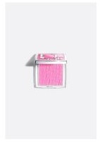
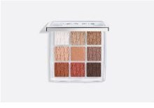

### Giảm giá sản phẩm và phiếu giao hàng

- Vendor đặt mức giảm 0-90% cho từng sản phẩm tại `/vendor/products` (ô "Giảm giá (%)"). `Product.getFinalPrice()` trả giá bán sau giảm, làm tròn đến đồng.
- Trang chủ, trang danh mục, trang shop, trang chi tiết và bảng sản phẩm của vendor hiện giá sau giảm kèm giá gốc gạch ngang. Giao diện dùng chung fragment `fragments/price`.
- Phiếu giao hàng in được tại `/vendor/orders/{id}/slip` (chỉ với đơn đã xác nhận trở đi). Phiếu có địa chỉ giao, danh sách sản phẩm, tổng tiền và số tiền thu hộ khi thanh toán COD.

## OneShop - phần Vendor của Jung Nguyễn

Mã này kết hợp bản `24162007_made4.zip` với các module Vendor được bổ sung. Nhánh GitHub `main` ban đầu mới chứa bộ khung Spring Boot; ZIP là nền tảng đầy đủ hơn để tiếp tục.

### Chạy demo không cần SQL Server

Yêu cầu Java 17+ và Maven. Trong thư mục dự án, chạy:

```powershell
mvn '-Dspring-boot.run.profiles=demo' spring-boot:run
```

Mở `http://localhost:8080/login`. Tài khoản mẫu `vendor@oneshop.com`, `admin@oneshop.com`, `user@oneshop.com`; mật khẩu demo chung `Oneshop@123`. Cơ sở dữ liệu H2 nằm trong bộ nhớ và được tạo lại khi khởi động. Chế độ thường không tự tạo tài khoản demo.

Shop mẫu `/shops/1` có 18 sản phẩm trang điểm high-end: 6 má hồng, 6 son môi và 6 bảng mắt. Thư mục `src/main/resources/static/images/products/` chứa ảnh tĩnh cho 27 sản phẩm demo (18 mỹ phẩm trang điểm và 9 sản phẩm chăm sóc da); `DemoSeeder` dùng đường dẫn `/images/products/...` nên ảnh không còn phụ thuộc CDN bên ngoài khi chạy ứng dụng. Các ảnh được đưa vào Git và sẽ hiển thị cho người clone repository, đồng thời có thể xem trước một số ảnh ngay trên trang này:

| Danh mục | Sản phẩm minh họa |
| --- | --- |
| Má hồng |  |
| Son môi |  |
| Bảng mắt |  |

Tên sản phẩm và ảnh demo được đối chiếu với các trang/CDN thương hiệu; danh sách nguồn và ghi chú từng ảnh nằm tại `src/main/resources/static/images/products/SOURCES.md`. Một số CDN chặn tải trực tiếp nên ảnh tương ứng được trích từ ảnh chụp catalog demo đã có. Các ảnh, giá và tồn kho chỉ phục vụ minh họa đồ án; không phải báo giá hay cam kết hàng thật. Shop thật cần tải ảnh mà mình có quyền sử dụng qua `/vendor/products`.

### Chạy với SQL Server

Sao chép `src/main/resources/application-example.properties` thành `application.properties` rồi điền kết nối SQL Server, JWT secret ít nhất 32 ký tự, Cloudinary và mail. File thật đã được `.gitignore` bỏ qua. Không đưa khóa thật vào GitHub.

### Các chức năng Vendor

| URL | Chức năng |
| --- | --- |
| `/shop/register` | User đăng ký shop, trạng thái chờ duyệt |
| `/admin/shops` | Admin/Manager duyệt shop và cấp vai trò Vendor |
| `/shops/{id}` | Trang shop công khai |
| `/vendor/shop` | Sửa tên, mô tả, địa chỉ, logo, banner |
| `/vendor/products` | Quản lý sản phẩm, ảnh, tồn kho, tìm kiếm, phân trang |
| `/vendor/orders` | Xác nhận/từ chối đơn, xử lý yêu cầu trả hàng |
| `/vendor/promotions` | Quản lý voucher của shop |
| `/vendor/revenue` | Doanh thu theo ngày/tháng/năm, trừ chiết khấu |

Các service kiểm tra shop sở hữu trước khi đọc/sửa sản phẩm, đơn hàng hoặc voucher. `PromotionService.calculate(code, shopId, subtotal, shippingFee)` trả giảm tiền hàng, giảm phí ship và tổng giảm; `redeem(...)` ghi lượt dùng trong giao dịch có khóa DB. Phần checkout của TV2 cần gọi `redeem(...)` trong cùng giao dịch tạo đơn, rồi lưu snapshot giá và giảm giá vào `Order`.

Khi Shipper chuyển đơn sang đã giao, module TV1 cần gọi `VendorOrderService.markDelivered(order)` để ghi thời điểm giao, tăng số đã bán và chốt tỷ lệ chiết khấu tại thời điểm đó. Không set `Order.status` trực tiếp ở nhiều module.

### VNPAY sandbox và hoàn tiền

Điền `vnpay.tmn-code`, `vnpay.hash-secret` và `vnpay.return-url` trong `application.properties`; IPN công khai phải được cấu hình tại VNPAY. Checkout của TV2 chuyển khách đến `/payment/vnpay/create?orderId=<id>` sau khi tạo đơn có `paymentMethod=VNPAY`. Callback `/payment/vnpay/return` và `/payment/vnpay/ipn` kiểm tra HMAC-SHA512, merchant, mã tham chiếu, số tiền và trạng thái trước khi cập nhật thanh toán. Hủy hoặc trả hàng đã thanh toán đưa tiền vào `REFUND_PENDING`; Vendor gửi lệnh hoàn qua trang chi tiết đơn. COD hoàn tiền mặt được xác nhận riêng. Không dùng khóa sandbox giả để ghi nhận giao dịch thành công.

Do chưa có mã VNPAY sandbox của nhóm, luồng thanh toán/hoàn tiền với cổng thật chưa được xác nhận; test hiện kiểm tra chữ ký, số tiền và callback lặp trên dữ liệu giả lập. Luồng checkout COD, giỏ hàng, lịch sử mua hàng phía User thuộc TV2 và vẫn là các màn hình mẫu trong ZIP.

### Kiểm thử

```powershell
mvn test
```

Test bao gồm khởi động H2, giảm giá voucher, doanh thu sau chiết khấu, quyền sở hữu dữ liệu và callback VNPAY. Ảnh minh chứng giao diện được bàn giao riêng trong thư mục `outputs` bên cạnh ZIP mã nguồn.
